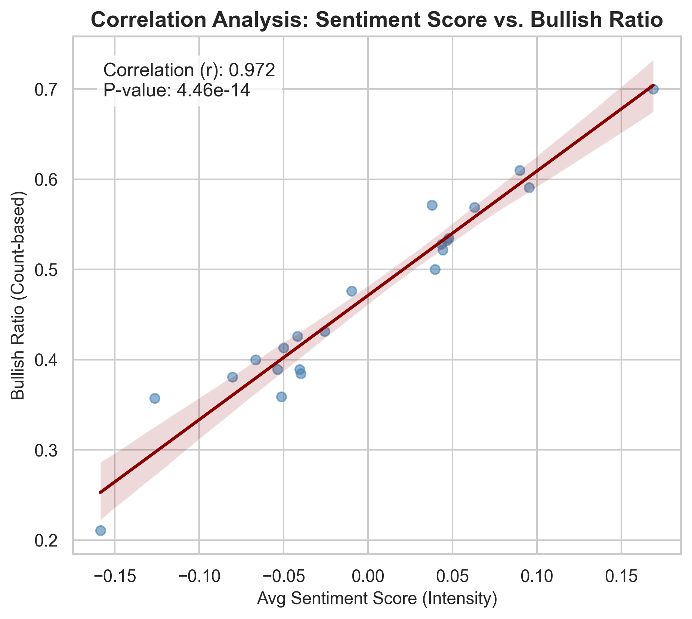

# Financial News Sentiment and U.S. Equity Markets

An exploratory study of financial news sentiment and daily market direction across four U.S. equity ETFs: QQQ, SPY, DIA, and IWM.

The project connects news collection, FinBERT fine-tuning, headline inference, and logistic regression in four Python notebooks. It examines how financial text can be converted into market-level features and compared with subsequent price movements.

**Current findings:** the saved analysis reports 65% in-sample accuracy for QQQ against a 55% majority-class baseline, using 20 observations. These results describe a small historical sample; out-of-sample predictive performance has not been established.

[Results](#results) · [Method](#method) · [Notebooks](#notebooks) · [Reproduction](#reproduction) · [中文摘要](#中文摘要)

## Results

The following values come from the saved output of [04_analysis.ipynb](notebooks/04_analysis.ipynb). The Logit model is fitted and evaluated on the same observations, with a classification threshold of 0.5. The baseline always predicts the more frequent market direction in that sample.

| ETF | Market exposure | Observations | In-sample accuracy | Majority baseline | Difference | Mean sentiment coefficient | p-value |
| --- | --- | ---: | ---: | ---: | ---: | ---: | ---: |
| QQQ | Nasdaq-100 | 20 | 65% | 55% | +10 pp | 14.61 | 0.091 |
| SPY | S&P 500 | 20 | 65% | 60% | +5 pp | 14.62 | 0.107 |
| DIA | Dow Jones Industrial Average | 20 | 60% | 55% | +5 pp | 9.06 | 0.197 |
| IWM | Russell 2000 | 20 | 60% | 60% | 0 pp | 7.99 | 0.281 |

Differences are in percentage points. For QQQ, +10 pp represents two additional correctly classified observations. Its sentiment coefficient meets a nominal 10% significance threshold, but not 5%; the reported p-values are not adjusted for testing multiple ETFs. The majority baseline comparison does not isolate the incremental contribution of sentiment relative to a return-only model.

## Method

### News and sentiment classification

The collection notebook queries Google News for Yahoo Finance headlines using source-related keywords and exclusions. Its settings target 30 days ending December 14, 2025. Search filters define the intended coverage; they do not establish a complete or independently verified news universe.

The training notebook fine-tunes `ProsusAI/finbert` for three sentiment classes using a local, headerless CSV with `sentiment,text` columns. Saved output records 4,846 labeled examples. The code uses a stratified 80/10/10 train, validation, and test split, three training epochs, and a learning rate of `2e-5`.

The local class mapping is `negative=0`, `neutral=1`, and `positive=2`. Inference applies the fine-tuned model to headlines and produces both a class label and a continuous score:

$$
s_i = P(\text{positive}\mid h_i) - P(\text{negative}\mid h_i)
$$

Here, $h_i$ is a headline. Scores range from −1 to 1. Accuracy and weighted F1 are defined for classifier evaluation, but the committed notebook does not retain final test metrics.

### Aggregate sentiment features

Headline scores are aggregated by date into a mean, standard deviation, and news count. A count-based measure is also constructed:

$$
S_d = \frac{1}{n_d}\sum_{i=1}^{n_d}s_i,
\qquad
B_d = \frac{N_{\text{positive},d}}{N_{\text{positive},d}+N_{\text{negative},d}}
$$

The bullish ratio excludes neutral headlines; it defaults to 0.5 when there are no positive or negative labels. The saved analysis reports a correlation of 0.9722 between mean sentiment and the bullish ratio. This measures agreement between two summaries of the same classifier output.



*Saved comparison of the two sentiment measures. This figure does not measure correlation with market returns.*

### Market-direction model

Adjusted ETF prices are downloaded with `yfinance` for the configured period from October 25 to December 16, 2025. The regression target is whether the daily close-to-close log return is positive. The fitted specification is:

$$
\log\frac{P(Y_t=1)}{1-P(Y_t=1)}
= \alpha + \beta_1 M^{*}_{t-1} + \beta_2 V^{*}_{t-1} + \gamma r_{t-1}
$$

Here, $r_{t-1}$ is the prior market log return in percentage units. $M^{*}$ and $V^{*}$ are sentiment features after the notebook's date mapping: dates are moved forward, Friday through Sunday are grouped into Monday, and the resulting feature rows are shifted once more before merging with market prices. Grouped mean sentiment is weighted by news count; grouped dispersion uses the maximum daily standard deviation.

This alignment is an implementation convention, not a verified publication-time alignment. It does not use a U.S. exchange holiday calendar. The bullish ratio is computed for comparison but is not included among the fitted regressors.

## Notebooks

| Notebook | Role | Main input or output |
| --- | --- | --- |
| [01_scraper.ipynb](notebooks/01_scraper.ipynb) | Collect search results and deduplicate links | Daily CSVs with `date`, `title`, `media`, `link` |
| [02_bert_training.ipynb](notebooks/02_bert_training.ipynb) | Fine-tune FinBERT and evaluate sentiment classification | `data/archive/all_data.csv` → `models/finbert_sentiment/` |
| [03_inference.ipynb](notebooks/03_inference.ipynb) | Deduplicate headlines and infer sentiment | `data/news_data/*.csv` → in-memory headline scores and labels |
| [04_analysis.ipynb](notebooks/04_analysis.ipynb) | Aggregate features, fit Logit models, and generate figures | `data/output/sentiment_data.csv` → regression output and `notebooks/plots/` |

News collection and classifier training can be prepared independently. Inference requires both the news CSVs and the trained model; analysis then requires an exported inference CSV.

The implementation uses Python, GoogleNews, pandas, Hugging Face Transformers and Datasets, PyTorch, scikit-learn, statsmodels, yfinance, Matplotlib, and Seaborn.

## Reproduction

This repository preserves research notebooks and saved figures. Data files and model weights are excluded by `.gitignore`, and the current notebooks require manual corrections before an end-to-end run.

### Environment and local files

```bash
git clone https://github.com/r13323038/News_Sentiment_Analysis.git
cd News_Sentiment_Analysis
python -m venv .venv
```

Activate the virtual environment using the command for your operating system. Notebook metadata records Python 3.13.2. [requirements.txt](requirements.txt) is an environment snapshot containing CUDA-specific PyTorch pins (`torch==2.9.1+cu126` and `torchvision==0.24.1+cu126`); installation requires a compatible package source and platform. For CPU or macOS use, those pins need to be adapted. The `Trainer` workflow also requires `accelerate`, which is absent from the snapshot. A clean installation has not been verified.

Prepare the following files and folders outside version control:

```text
data/
├── archive/all_data.csv          # Headerless sentiment,text training data
├── news_data/*.csv              # News CSVs: date,title,media,link
└── output/sentiment_data.csv    # Inference export consumed by analysis
models/
└── finbert_sentiment/           # Model and tokenizer saved by notebook 02
```

Open the notebooks with a Python kernel and use `notebooks/` as the working directory: their relative paths assume this location. The labeled dataset's source and acquisition instructions are not documented in the repository and must be established separately.

### Required notebook corrections

1. In `01_scraper.ipynb`, close the unfinished `print(...)` in the exception handler. Replace the undefined `base_dir` output configuration with the intended news folder, such as `drive_folder = os.path.join(project_root, 'data', 'news_data')`.
2. Run `02_bert_training.ipynb` with the labeled CSV available. Preserve its class mapping when loading the exported model for inference.
3. After inference in `03_inference.ipynb`, export the results expected by notebook 04:

   ```python
   output_path = project_root / "data" / "output" / "sentiment_data.csv"
   output_path.parent.mkdir(parents=True, exist_ok=True)
   df_news.to_csv(output_path, index=False, encoding="utf-8-sig")
   ```

4. Run `04_analysis.ipynb`. Its final cell calls `dfi.export`; add `import dataframe_image as dfi` if generating the daily report images.

These steps describe the missing connections identified from source inspection. The saved notebooks have not been rerun as part of this documentation update, and their outputs should not be treated as a reproducible execution record.

## Research limitations

- **Sample and evaluation.** Each market regression uses only 20 observations, with no chronological holdout or walk-forward evaluation. In-sample accuracy and nominal p-values provide limited evidence about generalization.
- **Timing and coverage.** Search dates are not verified article publication timestamps. Calendar mapping and the additional row shift require an exchange-calendar and information-availability audit before interpreting the features as tradable signals.
- **Classifier evaluation.** Labeled-data provenance, possible overlap with the pretrained model's data, final classification metrics, and probability calibration need verification before interpreting the sentiment scores as validated measurements.
- **Saved-output consistency.** Inference output reports 2,128 deduplicated headlines, while analysis output reports 2,024. The committed files do not explain that difference, so the two stages cannot yet be reconciled to one data snapshot.
- **Economic interpretation.** The notebooks contain no portfolio backtest, transaction costs, or risk-adjusted performance analysis. Classification accuracy alone does not establish investment value.

## 中文摘要

本專案以財經新聞標題為輸入，串接 Google News 資料蒐集、FinBERT 微調、情緒推論與動態 Logit 分析，探索新聞情緒與 QQQ、SPY、DIA、IWM 每日漲跌的關係。實作重點是將非結構化文字轉換為每日情緒特徵，再與市場資料整合。

現存 notebook 輸出中，QQQ 的樣本內準確率為 65%，高於多數類別基準的 55%，相差 10 個百分點；但迴歸僅使用 20 筆觀測，且在同一批資料上擬合與評估。情緒係數的 p-value 為 0.091，未達 5% 顯著水準，也未做多重檢定調整。目前結果適合定位為探索性研究，尚不足以主張已驗證的樣本外預測能力或交易績效。

重現分析前，需另行準備未納入版本控制的訓練資料、新聞資料與模型權重，並完成上述 notebook 銜接修正。後續研究應優先釐清資料來源、核對新聞可用時間與交易日對齊，再以時間順序切分或滾動樣本外評估檢驗結果。
